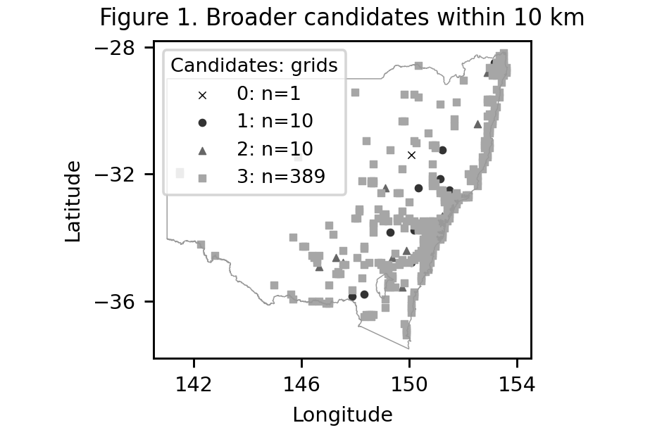
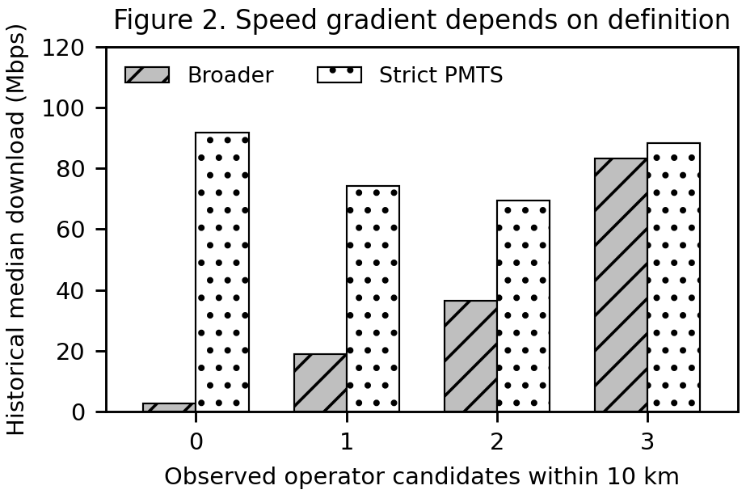

# The speed gradient appears under the broader operator-candidate classification, but is not reproduced under the strict classification

## Question

How do population and historical download speeds differ across NSW operator-candidate groups, and can persistent decline be compared? The speed gradient appears under the broader classification but is not reproduced under strict classification (Figure 2).

## Data

The original-method Ookla panel retains 410 NSW grids and 4,471 grid-quarter observations from 2019 Q1 to 2026 Q1. Rural observations remain subject to the original minimum of 50 tests. ACMA registrations describe October 2026 infrastructure candidates. Population comes from the ABS 2024 modelled one-kilometre raster, derived from small-area estimates and residential locations [1]. Population-growth predictive AP results are not used.

## Method

Exact corporate identities map registrations to Telstra, Optus and TPG/Vodafone. The strict definition retains explicit PMTS base records; the broader definition also includes inferred mobile-compatible spectrum registrations. Receivers, noncurrent licences and unrelated services are excluded. Sectors and repeated licences collapse to operator-location pairs; shared and ambiguous records remain qualified.

Great-circle searches count candidates within 5, 10 and 20 km. Each population raster cell is assigned once to the measured grid containing its centre, conditional on that centre being in NSW. No SA2 total is repeated across grids. Valid-cell matching and NoData are reported separately from zero population. Four cell-corner assignments assess border sensitivity; these are scenarios, not confidence intervals.

Speed is the median of grid-level historical medians. A raw persistent decline requires speeds in both following consecutive quarters to be at most 80% of baseline, with at least 50 tests throughout. Missing futures remain unknown. No model is trained.

## Result

At 10 km, broader groups with zero, one, two and three candidates contain 1, 10, 10 and 389 grids (Figure 1). Their historical median speeds are 2.83, 18.96, 36.50 and 83.15 Mbps. Strict-group medians are 91.67, 74.28, 69.54 and 88.43 Mbps, without a monotonic gradient.

The corresponding broader groups contain fewer than 100, approximately 1,100, 1,500 and 7.2 million modelled people within the observed grids. All 410 grids have some valid raster data; 15 are partial. Valid raster-cell matching is 100% in the first three groups and 99.93% in the last. Assignment scenarios place the last total between 6.91 and 7.24 million. These are estimated populations, not populations proven to depend on one network.

Within rural/regional grids, broader speeds remain ordered at 2.83, 18.96, 36.50 and 68.76 Mbps. All 84 urban grids fall in the broader three-candidate group, preventing an urban comparison. The broader ordering persists across search radii, while strict results do not.

All 3,198 eligible decline windows belong to the broader three-candidate group at 10 km; 180 decline and 1,273 baseline rows are unassessable. Consequently, greater decline vulnerability cannot be compared.

## Limitation

Population is modelled for 2024, while infrastructure is a 2026 snapshot and speeds span different histories. A grid inherits its centre’s classification; people elsewhere in that grid may face different infrastructure. Raster missingness, boundary assignment, self-selected tests and thin rural histories limit interpretation. Counts cover measured grids, not statewide residents or operational coverage.

Registration does not establish live service, independent power/backhaul or a defensible 4G/5G indicator. No causal or predictive effect is established. ACMA permits emergency calls through another available network, but its 2023 Optus investigation documents failed emergency access [2]. Nearby infrastructure therefore cannot guarantee successful calls. Signal strength, voice quality and emergency-call success were not measured.

Figure 1. Broader candidate groups at 10 km; symbols mark measured grid centres, not coverage.

Figure 2. Historical median speeds by classification. The broader gradient is absent under strict PMTS classification.

[1] [ABS population source and methodology](POPULATION_METHOD.md). [2] [ACMA guidance and investigation](SOURCES.md#emergency-calling).

Based on Australian Communications and Media Authority information.
